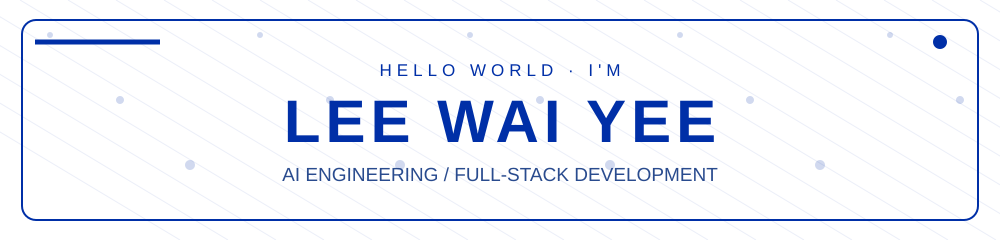

<div align="center">




[](https://wwaiyyee.vercel.app/) [](https://www.linkedin.com/in/lee-wai-yee) [](mailto:wwaiyyee@gmail.com)


</div>

## 01 / About Me

I'm **Lee Wai Yee**, a **Computer Science (Artificial Intelligence)** graduate from **Taylor's University**, passionate about bringing intelligent ideas to life. I work across **computer vision, AI agents, model evaluation, and full-stack applications**, with industry experience in eKYC and secure customer onboarding at **TNG Digital**.

```python
class WaiYee:
    focus = ["Applied AI", "Agentic Systems", "Computer Vision", "Full-Stack"]
    experience = "AI Engineering · TNG Digital"
    education = "Taylor's University · First Class Honours · CGPA 3.78"
    philosophy = "Build thoughtfully. Validate with evidence. Ship something useful."
```

> I enjoy turning experimental prototypes into useful, working products — especially when there is an interesting technical problem to solve.

<div align="center"></div>

## 02 / Tech Stack & Skills

<div align="center">

**LANGUAGES**


**AI / MACHINE LEARNING / DATA**


`Computer Vision` · `YOLO` · `LLMs / VLMs` · `AI Agents` · `Model Evaluation` · `Pandas` · `DuckDB`

**FRAMEWORKS / CLOUD / TOOLS**


</div>

<div align="center"></div>

## 03 / Hackathon Achievements & Winning Projects

| Project | Recognition | What it does | Code |
|:--|:--|:--|:--|
| **IntelliTrade** | 🏆 ETHOnline 2025 · Lighthouse Prize | AI data agent for decentralized discovery and analytics, with verifiable access and token gating. | [Repository](https://github.com/Jay-366/ethonline) |
| **EthCLBet** | 🏆 DEVMatch 2025 · Ethereum Foundation Best Tooling; 2nd Place, The Graph | Prediction-market aggregator and allocation optimizer powered by decentralized data and smart contracts. | [Repository](https://github.com/Cedctf/ethclbet) |
| **IntelliBox** | 🥇 Tech Trove 2.0 · 1st Prize | Multi-agent automation platform for proposals, presentations, and emails. | [Repository](https://github.com/Jay-366/techtrove2.0) |
| **Realytic** | 🏅 VHack 2026 · 5th Place | Multimodal deepfake and fraud detection using video, image, audio, and risk assessment. | [Repository](https://github.com/wwaiyyee/vhack) |

<details>
<summary><b>✦ More hackathon milestones</b></summary>

- **Cursor x Anthropic Hackathon 2025:** Top 15 finalist — *Twinkle*.
- **ImagineHack 2025:** Top 14 finalist — *CutiCuti Malaysia*.

</details>

<div align="center"></div>

## 04 / GitHub Stats & Contribution Art

<div align="center">


**THE CONTRIBUTION SNAKE**


<sub>The snake animation appears after the included GitHub Actions workflow has successfully published its first output.</sub>

</div>

<div align="center"></div>

## 05 / Let's Connect

<div align="center">

Interested in applied AI, hackathons, or building something ambitious together? **Let's connect.**

[](https://www.linkedin.com/in/lee-wai-yee) [](https://wwaiyyee.vercel.app/) [](mailto:wwaiyyee@gmail.com)


</div>
